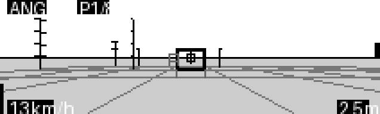
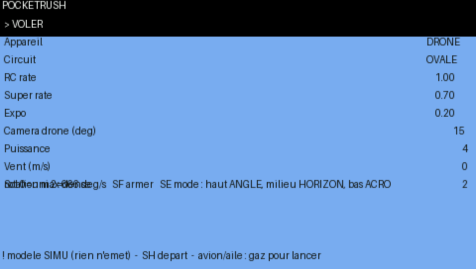

# PocketRush

**Le FPV dans ta poche.** Un mini simulateur FPV qui tourne directement dans ta radio EdgeTX. Pas besoin d'ordinateur ni de câble : tu choisis un modèle qui n'émet pas et tu voles avec tes vrais manches et interrupteurs.

🇬🇧 [English version](README.md)

| Taranis X9D+ (212×64, niveaux de gris) | Écran couleur (480×272) |
|---|---|
|  |  |
|  |  |
|  |  |

*Captures du banc d'essai sur PC. Sur une vraie radio, les polices sont plus petites.*

## Fonctionnalités

- **Drone, avion et aile volante.** L'avion a besoin de vitesse, décroche et pique du nez s'il est trop lent. L'aile n'a pas de dérive et roule plus vite.
- **3 circuits de 8 portes** : OVALE, HUIT (en forme de 8) et VAGUE (portes de 2 à 14 m de haut).
- **3 modes de vol** sur un interrupteur : Angle / Horizon / Acro pour le drone, Stab / Horizon / Manuel pour l'avion et l'aile.
- **Rates Betaflight** : RC rate, super rate et expo, avec la même formule que Betaflight.
- **Chrono et records** par appareil et par circuit, gardés sur la carte SD.
- **Un fantôme** qui rejoue ton meilleur tour.
- **Du vent**, avec des rafales.
- **Des repères de hauteur et de vitesse** : horizon, quadrillage au sol, poteaux gradués tous les 3 m, ombre, variomètre et barre des gaz.

## Radios compatibles

| Radio | État |
|---|---|
| Taranis X9D+ 2019, EdgeTX 2.11 | ✅ Testée |
| Autres radios 212×64 (X9D, X9D+, X9E) | Devraient marcher : même écran |
| Radios couleur EdgeTX (TX16S…) | Prises en charge, testées sur le banc d'essai PC |
| Radios 128×64 (QX7, X9 Lite, TX12, Zorro…) | Pas testées |

Ta radio doit avoir les interrupteurs **SE**, **SF** et **SH** (voir [Commandes](#commandes)).

## Installation

1. Branche la radio en USB, en mode **Stockage**, ou retire sa carte SD.
2. Copie [`SCRIPTS/TOOLS/PocketRush.lua`](SCRIPTS/TOOLS/PocketRush.lua) dans le dossier **`/SCRIPTS/TOOLS/`** de la carte SD.
3. Sur la radio, appuie sur **SYS**, va dans la page **Outils** et choisis **PocketRush**. Le premier lancement prend quelques secondes.

## ⚠️ Sécurité

PocketRush lit tes **vrais manches et interrupteurs**. Avant de le lancer, **choisis un modèle qui n'émet pas**, avec le module interne et le module externe coupés. Sinon, un appareil allumé et armé réagirait aussi à tes manches.

## Commandes

| Commande | Dans le menu | En vol |
|---|---|---|
| **Molette** (ou + / −) | Choisir une ligne ; en modification, changer la valeur | — |
| **ENT** | Modifier, puis valider une valeur. Sur **> VOLER** : décoller | Recommencer |
| **EXIT** | Annuler la modification, puis quitter | Revenir au menu |
| **SF** | — | Armer / désarmer (gaz à zéro pour armer) |
| **SE** | — | Mode : haut Angle / Stab, milieu Horizon, bas Acro / Manuel |
| **SH** (ressort) | — | Revenir au départ |

**Avion et aile :** une fois armé, mets plus de 30 % de gaz pour un lancement à la main.

Si tu désarmes en l'air, les moteurs s'arrêtent et l'appareil tombe, comme en vrai.

## Réglages

| Ligne du menu | Rôle | Par défaut |
|---|---|---|
| Appareil | DRONE, AVION ou AILE | DRONE |
| Circuit | OVALE, HUIT ou VAGUE | OVALE |
| RC rate / Super rate / Expo | Rates Betaflight | 1.00 / 0.70 / 0.20 (667°/s) |
| Caméra drone | Inclinaison de la caméra du drone, en degrés | 15 |
| Puissance | Poussée maximale | 4 |
| Vent | Vent en m/s, direction au hasard à chaque départ | 0 |
| Sol | Densité du quadrillage au sol (0 = sol uni) | 2 |

## L'écran de vol

- **En haut :** mode (ou DESARME), numéro de la prochaine porte, chrono du tour et record.
- **En bas :** vitesse et hauteur.
- **Sur les bords :** barre des gaz à gauche, variomètre à droite.
- **La prochaine porte** est en gras, avec un petit carré au centre. Quand elle sort de l'écran, **<<** ou **>>** indique de quel côté tourner.
- **Le fantôme** de ton meilleur tour est une croix.

## Dépannage

| Problème | Solution |
|---|---|
| PocketRush n'apparaît pas dans Outils | Vérifie que le fichier est bien dans `/SCRIPTS/TOOLS/` et finit par `.lua` |
| « not enough memory » | Redémarre la radio et relance PocketRush ; ouvre une issue pour le signaler |
| L'affichage est lent | Baisse **Sol** à 1 ou 0 |
| Il ne s'arme pas | Gaz à zéro, puis bascule **SF**. Si SF était déjà sur « armé », baisse-le puis relève-le |
| Les records ont disparu | Ils sont dans `/SCRIPTS/TOOLS/PocketRush.rec` : garde ce fichier |

## Contribuer

Les bugs, les idées, ainsi que les vidéos et photos sur de vraies radios sont les bienvenus dans les [issues](../../issues). Les pull requests aussi.

## Licence

[GNU GPL v3](LICENSE) © starman-tech
