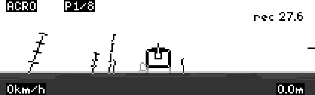
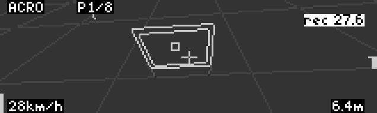
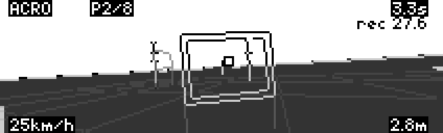
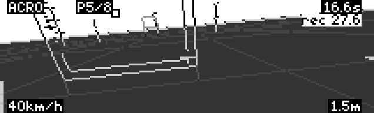
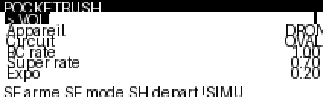
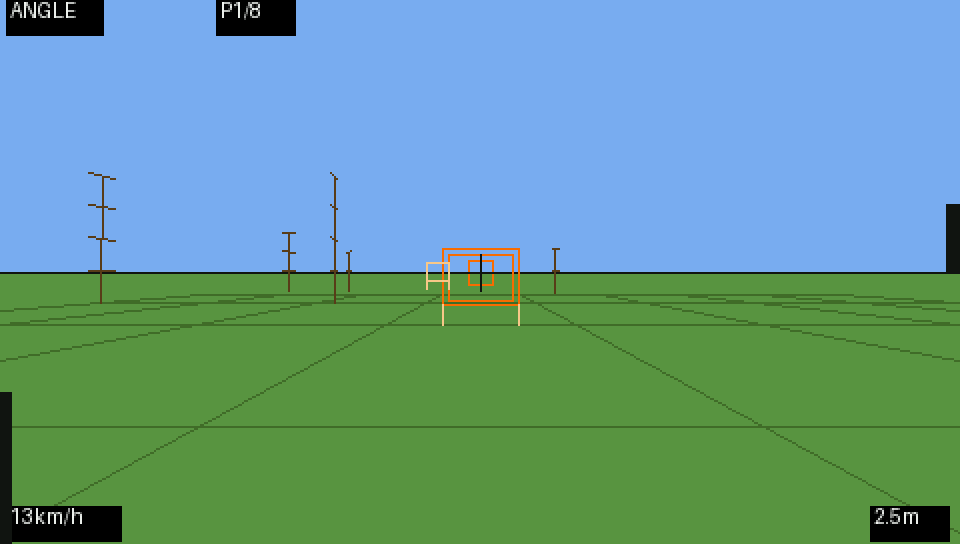
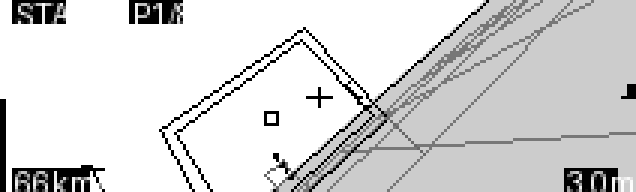
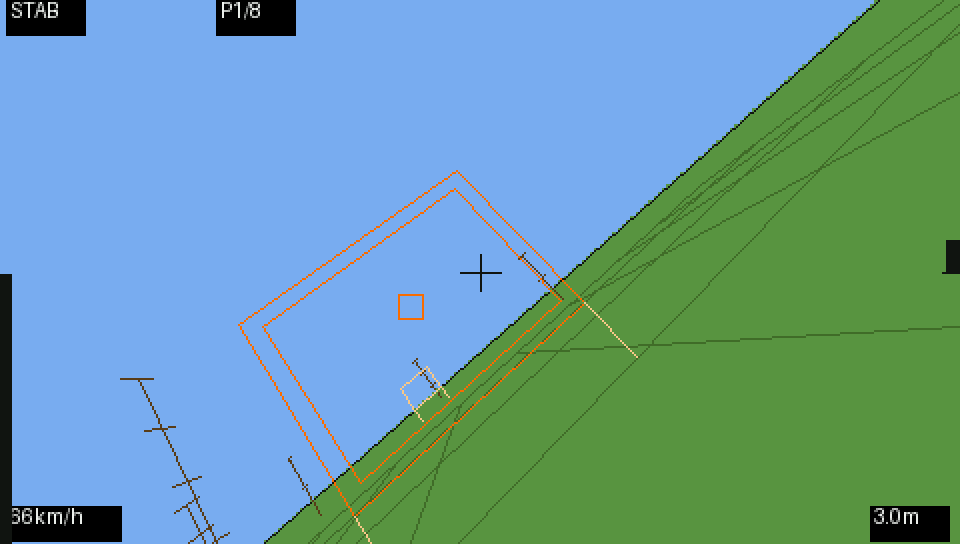

# PocketRush

**FPV in your pocket.** A tiny FPV simulator that runs right on your EdgeTX radio. You need no computer and no cable: pick a model that doesn't transmit and fly with your real sticks and switches.

🇫🇷 [Version française](README.fr.md)

| On a real Taranis X9D+ 2019 | |
|---|---|
|  |  |
|  |  |

*Real screenshots taken on the radio, flying in Acro mode.*

| Menu and plane (212×64) | Color screen (480×272) |
|---|---|
|  |  |
|  |  |

*Renders from the PC test bench. Fonts are smaller on a real radio.*

## Features

- **Quad, plane and flying wing.** The plane needs airspeed, stalls and drops its nose when too slow. The wing has no rudder and a faster roll.
- **3 tracks of 8 gates**: OVALE (oval), HUIT (figure-8) and VAGUE (gates from 2 m to 14 m high).
- **3 flight modes** on one switch: Angle / Horizon / Acro for the quad, Stab / Horizon / Manual for the plane and the wing.
- **Betaflight rates**: RC rate, super rate and expo, with the same formula as Betaflight.
- **Lap timer and records** for each aircraft and track, saved on the SD card.
- **A ghost** that replays your best lap.
- **Wind** with gusts.
- **Height and speed cues**: horizon, ground grid, poles marked every 3 m, your shadow, a variometer and a throttle bar.

## Compatible radios

| Radio | Status |
|---|---|
| Taranis X9D+ 2019, EdgeTX 2.11 | ✅ Tested |
| Other 212×64 radios (X9D, X9D+, X9E) | Should work: same screen |
| EdgeTX color radios (TX16S…) | Supported, tested on the PC test bench |
| 128×64 radios (QX7, X9 Lite, TX12, Zorro…) | Not tested |

Your radio needs the **SE**, **SF** and **SH** switches (see [Controls](#controls)).

## Install

1. Connect the radio over USB in **Storage** mode, or take out its SD card.
2. Copy [`SCRIPTS/TOOLS/PocketRush.lua`](SCRIPTS/TOOLS/PocketRush.lua) to the **`/SCRIPTS/TOOLS/`** folder on the SD card.
3. On the radio, press **SYS**, open the **Tools** page and select **PocketRush**. The first launch takes a few seconds.

## ⚠️ Safety

PocketRush reads your **real sticks and switches**. Before you launch it, **select a model that doesn't transmit**, with internal and external RF turned off. Otherwise a powered, armed aircraft would react to your sticks too.

## Controls

| Control | In the menu | In flight |
|---|---|---|
| **Scroll wheel** (or + / −) | Choose a line; while editing, change the value | — |
| **ENT** | Edit, then confirm a value. On **> VOLER**: take off | Restart |
| **EXIT** | Cancel the edit, then quit | Back to the menu |
| **SF** | — | Arm / disarm (throttle at zero to arm) |
| **SE** | — | Mode: up Angle / Stab, middle Horizon, down Acro / Manual |
| **SH** (momentary) | — | Back to the start line |

**Plane and wing:** once armed, push the throttle above 30 % to hand-launch.

If you disarm in the air, the motors stop and the aircraft falls, just like the real thing.

## Settings

The radio menu is in French. Here is what each line means:

| Menu line | Meaning | Default |
|---|---|---|
| Appareil | Aircraft: DRONE (quad), AVION (plane), AILE (wing) | DRONE |
| Circuit | Track: OVALE, HUIT, VAGUE | OVALE |
| RC rate / Super rate / Expo | Betaflight rates | 1.00 / 0.70 / 0.20 (667°/s) |
| Caméra drone | Quad camera tilt, in degrees | 15 |
| Puissance | Maximum thrust | 4 |
| Vent | Wind in m/s; random direction on every start | 0 |
| Sol | Ground grid density (0 = plain ground) | 2 |

## The flight screen

- **Top:** flight mode (or DESARME), next gate number, lap time and best lap.
- **Bottom:** speed and height.
- **Edges:** throttle bar on the left, variometer on the right.
- **The next gate** is drawn bold with a small square in its center. When it is off screen, **<<** or **>>** shows which way to turn.
- **The ghost** of your best lap is a cross.

## Troubleshooting

| Problem | Fix |
|---|---|
| PocketRush is missing from Tools | Check that the file is in `/SCRIPTS/TOOLS/` and has the `.lua` extension |
| "not enough memory" | Restart the radio and launch PocketRush again; please open an issue |
| The display is slow | Lower **Sol** to 1 or 0 |
| It won't arm | Throttle to zero, then flip **SF**. If SF was already on, flip it off and on again |
| Records are gone | They live in `/SCRIPTS/TOOLS/PocketRush.rec`, so keep that file |

## Contributing

Bug reports, ideas, videos and screenshots from real radios are welcome in the [issues](../../issues), and so are pull requests.

To take a screenshot: in **MDL**, on the **Special Functions** page, assign **Screenshot** to a free switch. Each flip saves an image to the `SCREENSHOTS` folder on the SD card.

## License

[GNU GPL v3](LICENSE) © starman-tech
